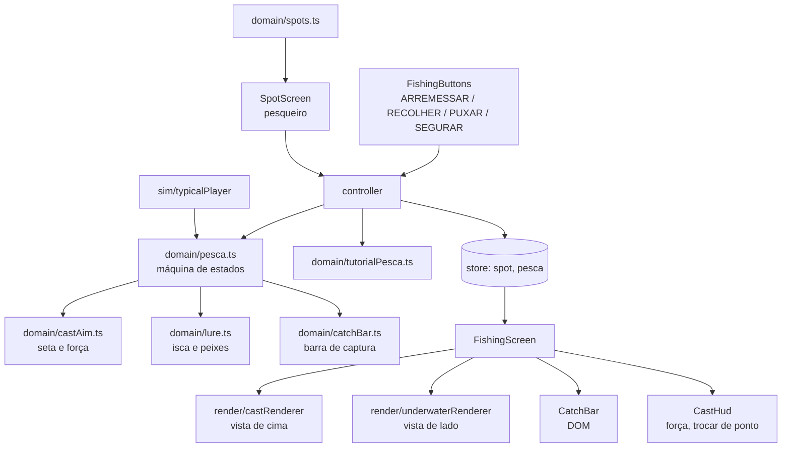

# Pescaria nova Design

**Spec**: `.specs/features/pesca-bass/spec.md`
**Status**: Approved (2026-10-31)

---

## Architecture Overview

Segue o AD-002 (domínio em TypeScript puro com tempo e sorteio injetados, interface em Preact, desenho em Canvas 2D) e o AD-004 (conteúdo por episódio). A pescaria nova nasce em arquivos novos ao lado da antiga, com testes próprios, e entra no jogo numa troca única; depois a antiga é apagada. Assim cada tarefa termina com o jogo compilando e todos os testes passando.

Abordagens consideradas (recomendada primeiro):

1. **Máquina de estados nova em arquivos novos, troca única, limpeza depois** (escolhida). Gates verdes a cada tarefa; a troca é uma tarefa grande, mas mecânica.
2. Reescrever `fishing.ts` no lugar. Quebra controlador, desenho, telas e simulação no mesmo commit; tarefas intermediárias ficariam vermelhas.
3. Motor de jogo (Phaser, Kaplay) para as cenas. Contraria o AD-002 e soma uns 1 MB ao pacote de 5 MB.



---

## Code Reuse Analysis

### Existing Components to Leverage

| Component | Location | How to Use |
| --------- | -------- | ---------- |
| RNG com semente | `src/domain/rng.ts` | Sorteio de peixes, destinos e tempos (`range`, `pick` com peso) |
| Sorteio de peso e valor | `src/domain/fishing.ts` (`caught`) | Move para `pesca.ts` sem mudar (PESCA-15 a 17) |
| Cenário por local | `src/render/scenery.ts`, `stands.ts`, `adilson.ts`, `sprites.ts` | Vista de cima do arremesso e do pesqueiro; paleta da vista debaixo d'água |
| Desenho da água e do Adilson | `src/render/fishingRenderer.ts` (`drawWater`, `rod`, `line`, `splash`) | Base do `castRenderer`, com uma vara só |
| Layout e escala da cena | `fishingRenderer.ts` (`computeLayout`, `sceneScale`) | Mesma cena lógica 180 × 400 |
| Medidores | `src/ui/FishingGauges.tsx` | Linha e Profundidade passam a ler a isca; o medidor de tensão sai |
| Ficha, celebração, diálogos, torneio | `src/ui/FishCard.tsx`, `Celebration.tsx`, `DialogBox.tsx`, `Tournament.tsx` | Continuam lendo `Result_Caught`; só os nomes de fase que mudaram são trocados |
| Torneio | `src/domain/tournament.ts` (`record`) | Já conta qualquer `Result_*` como arremesso; passa a receber o estado novo |
| Álbum | `src/domain/album.ts` | "???" das espécies não pescadas no pesqueiro (PONTO-02) |
| Ganchos de teste | `src/app/testHooks.ts`, `e2e/support.ts` | Ganham `button(...)`, `hold(...)` e `autoplay(...)` |

### Integration Points

| System | Integration Method |
| ------ | ------------------ |
| Store | `GameState.fishing` passa a ser `PescaState`; novo `GameState.spot: string \| null` (fora do salvamento) |
| Controlador | Comandos novos `chooseSpot`, `leaveSpot`, `pressButton`, `holdStart`, `holdEnd`; sai `tapWater` |
| Conteúdo | `Zone` ganha `name` e `minReach`; `Species` ganha `fightStyle?` |
| Simulação | `typicalPlayer` joga com `pesca.ts` e uma política de botões |

---

## Components

### castAim (domínio)

- **Purpose**: Seta que balança, barra de força e distância do arremesso.
- **Location**: `src/domain/castAim.ts`
- **Interfaces**:
  - `aimAngleDeg(sinceS: number, sweepS: number): number` - onda triangular de -45° a 45°, ida e volta em `sweepS` (ARREM-01, ARREM-06)
  - `powerAt(sinceS: number, sweepS: number): number` - onda triangular 0 → 1 → 0 (ARREM-02)
  - `castDistanceM(power: number, reach: number): number` - `(0,3 + 0,7 × power) × maxCastDistance(reach) × M_PER_PX` (ARREM-03, ARREM-07)
- **Dependencies**: `tuning.ts`
- **Reuses**: `maxCastDistance` (movido de `fishing.ts`)

### lure (domínio)

- **Purpose**: A água de um arremesso: a isca, os peixes, o interesse, a recusa e o ataque.
- **Location**: `src/domain/lure.ts`
- **Interfaces**:
  - `spawnWater(spot: Zone, species: Species[], distanceM: number, rng: Rng, followWithinS: number | null): Water` (ISCA-01, PONTO-06, TUTOB-02)
  - `stepWater(w: Water, dt: number, reeling: boolean, bait: BaitId, rng: Rng): { water: Water; strike: FishAgent | null }` (ISCA-02, 04 a 07, 14, 15)
  - `twitch(w: Water): Water` - tranco e adianta ataques (ISCA-03, ISCA-07)
  - `scare(w: Water, fishId: number): Water` - fisgada perdida (ISCA-11)
- **Dependencies**: `rng.ts`, `tuning.ts`
- **Reuses**: `Species.baits`, `Species.rarity`, `Zone.depthM`

### catchBar (domínio)

- **Purpose**: A física da briga no estilo Stardew, a partir do código de conceito do usuário, em segundos.
- **Location**: `src/domain/catchBar.ts`
- **Interfaces**:
  - `startBar(sp: Species, rod: Rod, rules: BarRules, rng: Rng): CatchBar` (BRIGA-01, BRIGA-07, BRIGA-12)
  - `stepBar(b: CatchBar, dt: number, holding: boolean, rules: BarRules, rng: Rng): CatchBar` (BRIGA-02 a 06, 08, 09, 12, 14)
  - `barOutcome(b: CatchBar, rules: BarRules): 'pegou' | 'fugiu' | null` (BRIGA-10, BRIGA-11)
  - `fishInside(b: CatchBar): boolean`
  - `fightStyleOf(sp: Species): FightStyle` - campo da espécie ou o padrão pela força
- **Dependencies**: `rng.ts`, `tuning.ts`
- **Reuses**: `Species.power`, `Species.stamina`, `Rod.force`

### spots (domínio)

- **Purpose**: O que o pesqueiro mostra para cada ponto.
- **Location**: `src/domain/spots.ts`
- **Interfaces**:
  - `spotsFor(loc: Location, rod: Rod, species: Species[], album: Profile['album']): SpotView[]` - nome, cadeado, alcance pedido e espécies (nome ou "???") (PONTO-01 a PONTO-03)
- **Reuses**: `Zone`, `album.ts`

### pesca (domínio)

- **Purpose**: A máquina de estados de um arremesso, da mira ao resultado.
- **Location**: `src/domain/pesca.ts`
- **Interfaces**:
  - `startPesca(): PescaState` - fase `Aim`
  - `rulesFor(d: Difficulty): PescaRules`
  - `press(s: PescaState, b: 'arremessar' | 'puxar', ctx: PescaContext): PescaState` - trava a seta, arremessa, dá tranco ou fisga (ARREM-02, 03, ISCA-03, ISCA-10)
  - `tick(s: PescaState, dt: number, input: { holding: boolean }, ctx: PescaContext): PescaState` (ARREM-04, 05, ISCA-08, 11, 12, BRIGA-*)
  - `caught(sp: Species, rng: Rng)` - movido de `fishing.ts`
- **Dependencies**: `castAim`, `lure`, `catchBar`
- **Reuses**: `caught`, `Gear`

### tutorialPesca (domínio)

- **Purpose**: Os passos da Jane na pescaria nova e as regras folgadas do tutorial.
- **Location**: `src/domain/tutorialPesca.ts`
- **Interfaces**: `start()`, `onPesca(t, s: PescaState, spotChosen: boolean)`, `tick(t, dt, touched)`, `rules(t, d): PescaRules` (TUTOB-01 a TUTOB-04; o "repetir instrução" da v1, TUTO-07, continua)
- **Reuses**: o formato de `tutorial.ts`

### typicalPlayer (simulação)

- **Purpose**: Jogar episódios inteiros com a pescaria nova para medir a progressão.
- **Location**: `src/domain/sim/typicalPlayer.ts` (modificar)
- **Interfaces**: `simulateEpisode(...)` igual; `holdPolicy(b: CatchBar, delayedFishY: number): boolean` exportada e reaproveitada pelo `autoplay` do teste de tela (SIMB-01, SIMB-02)

### castRenderer (desenho)

- **Purpose**: Vista de cima: pesqueiro com os pontos, mira, voo da isca e respingo; o Adilson com uma vara só.
- **Location**: `src/render/castRenderer.ts`
- **Interfaces**: `createCastRenderer(opts): { resize, draw(view: CastView, t), destroy }`; puras: `landingPoint(angleDeg, distanceM): Point`, `spotAnchor(zone: Zone): Point`
- **Reuses**: `fishingRenderer.ts` (água, vara, linha, respingo, layout), `scenery.ts`, `adilson.ts`, `stands.ts`

### underwaterRenderer (desenho)

- **Purpose**: Vista de lado: superfície, fundo, plantas, peixes, isca, linha, "!" e "não gostou"; na briga, o peixe se debatendo.
- **Location**: `src/render/underwaterRenderer.ts`
- **Interfaces**: `createUnderwaterRenderer(opts)`; puras: `camera(lureXM, bottomM, layout): Camera`, `toScene(cam, xM, depthM): Point`
- **Reuses**: paleta do `scenery.ts`, `sprites.ts` (silhueta e cor de cada espécie até a arte chegar)

### Telas (Preact)

| Componente | Location | O que faz | Requisitos |
| ---------- | -------- | --------- | ---------- |
| FishingButtons | `src/ui/FishingButtons.tsx` | ARREMESSAR, RECOLHER + PUXAR ou SEGURAR conforme a fase; apagado sem efeito; reage no encostar; um dedo só | BOTAO-01 a 05, ISCA-08 (pisca "FISGAR!") |
| SpotScreen | `src/ui/SpotScreen.tsx` | Fundo do castRenderer no modo pesqueiro, um botão por ponto na âncora, painel com espécies, cadeado e "Pescar aqui" | PONTO-01 a 04 |
| CastHud | `src/ui/CastHud.tsx` | Barra de força e botão "Trocar de ponto" | ARREM-02, PONTO-05 |
| CatchBar | `src/ui/CatchBar.tsx` | Barra vertical com faixa e peixe em % da altura e medidor ao lado | BRIGA-01, BRIGA-13 |
| FishingScreen | `src/ui/FishingScreen.tsx` (modificar) | Escolhe pesqueiro, vista de cima ou de lado pela fase; avisos "Nada dessa vez", "Escapou!", "O peixe fugiu!" | ISCA-11, 12, BRIGA-11 |
| TutorialCoach | `src/ui/TutorialCoach.tsx` (modificar) | Setas para os botões e o ponto, por passo | TUTOB-01 |

---

## Data Models

```typescript
// content/types.ts (acréscimos)
interface Zone { /* ...v1 */ name: string; minReach: number }
type FightStyle = 'calmo' | 'saltador' | 'afundador';
interface Species { /* ...v1 */ fightStyle?: FightStyle }

// domain/lure.ts
interface FishAgent {
  id: number;
  species: Species;
  xM: number; // distância até o Adilson
  depthM: number;
  dir: 1 | -1;
  mode: 'nadando' | 'seguindo' | 'recusou' | 'fugindo';
  attackInS: number | null; // só no modo 'seguindo'
}
interface Water { spot: Zone; bottomM: number; lure: { xM: number; depthM: number }; fish: FishAgent[]; nextId: number }

// domain/catchBar.ts (alturas de 0 = fundo a 1 = topo da barra)
interface CatchBar {
  style: FightStyle;
  zoneY: number; zoneV: number; zoneH: number; // faixa verde: base, velocidade, altura
  fishY: number; fishTarget: number; retargetInS: number;
  meter: number; // 0 a 1, começa em 0,3
  species: Species; force: number;
}
interface BarRules { zoneScale: number; fishSpeedScale: number; retargetScale: number; drainPerS: number; meterFloor: number; style?: FightStyle }

// domain/pesca.ts
interface PescaRules { sweepS: number; hookWindowS: number | null; followWithinS: number | null; bar: BarRules }
type PescaState =
  | { phase: 'Aim'; sinceS: number }
  | { phase: 'Power'; angleDeg: number; sinceS: number }
  | { phase: 'Flying'; gear: Gear; angleDeg: number; distanceM: number; sinceS: number }
  | { phase: 'Lure'; gear: Gear; water: Water; notice: { text: string; sinceS: number } | null }
  | { phase: 'Strike'; gear: Gear; water: Water; fishId: number; sinceS: number }
  | { phase: 'Fight'; gear: Gear; water: Water; fishId: number; bar: CatchBar }
  | { phase: 'Result_Caught'; species: Species; kg: number; value: number }
  | { phase: 'Result_Escaped' } // BRIGA-11
  | { phase: 'Result_Nothing' }; // ISCA-12

// app/store.ts
interface GameState { /* ...v1 */ fishing: PescaState; spot: string | null }
```

**Relationships**: o ponto (`spot`) é o `Zone.id` do local atual; `null` mostra o pesqueiro. O resultado de um arremesso vai para o torneio (`tournament.record`), a ficha e as medalhas como na v1; fechada a ficha, a pesca volta a `Aim` no mesmo ponto.

---

## Error Handling Strategy

| Error Scenario | Handling | User Impact |
| -------------- | -------- | ----------- |
| Botão tocado em fase sem efeito | `press` devolve o mesmo estado; o botão aparece apagado | Nada acontece (BOTAO-03) |
| Dois peixes atacam no mesmo passo | `stepWater` devolve só o primeiro; o outro passa a `fugindo` | Um "!" só (ISCA-14) |
| Ponto sem espécie que aceita a isca | Os peixes nadam, olham e recusam | "não gostou" nos peixes; o jogador troca a isca (ISCA-06) |
| App vai para segundo plano no meio do arremesso | Pausa da v1 (SAVE-01) congela o `tick` | Tudo parado até tocar (PAUSA-01) |
| Reabrir o jogo no meio de um arremesso | `fishing` e `spot` não são salvos | Volta ao pesqueiro do último local (EPI-07) |
| `dt` grande (aba voltando) | O laço já limita o passo; `stepBar` e `stepWater` subdividem passos acima de 1/30 s | Física igual em qualquer celular |

---

## Risks & Concerns

| Concern | Location (file:line) | Impact | Mitigation |
| ------- | -------------------- | ------ | ---------- |
| Muitas telas leem `fishing.phase` com nomes da v1 (`Idle`, `Bite`, `Fight`, `Result_Broken`) | `src/ui/Celebration.tsx`, `DialogBox.tsx`, `FishCard.tsx`, `Letter.tsx`, `Tournament.tsx`, `TutorialCoach.tsx` | A troca quebra a compilação em vários arquivos | O TypeScript aponta cada uso; a tarefa de troca ajusta todos de uma vez, e os resultados mantêm os mesmos nomes (`Result_Caught`, `Result_Escaped`, `Result_Nothing`) |
| Testes de tela dirigem a pesca tocando na cena (`toScreen`, `advanceUntil('Bite')`) | `e2e/support.ts:46`, `e2e/fishing.spec.ts` e outros | Quebram na troca | A troca reescreve as ajudas (`castNow`, `hookNow`, `autoplay`) e os testes que usam a pesca; os critérios da v1 que saem (PESCA-01 a 14) têm os testes trocados pelos da spec nova, não apagados sem substituto |
| Duas varas no desenho do Adilson de costas | `src/render/fishingRenderer.ts:271` com o sprite `src/assets/adilson/*.png` | Visual estranho (apontado na Fase 10) | `castRenderer` desenha só a linha a partir da ponta da vara do sprite |
| Simulação passo a passo fica lenta (horas de jogo por semente) | `src/domain/sim/typicalPlayer.ts` | Calibragem demorada | Passo de 0,1 s na simulação; o teste unitário roda poucas sementes; a calibragem completa é tarefa separada |
| Briga contínua pode cansar quem joga deitado | Física em `catchBar.ts` | Frustração | No Tranquilo o medidor nunca desce de 10% e a faixa é 40% maior (BRIGA-12); números em `tuning.ts` |

---

## Tech Decisions (only non-obvious ones)

| Decision | Choice | Rationale |
| -------- | ------ | --------- |
| Onde fica a barra de captura | DOM (Preact), não Canvas | Posições em % testáveis no e2e e acessíveis; o Canvas fica só para as cenas |
| Unidade da barra | Altura relativa (0 a 1) | Independe do tamanho da tela |
| Física em segundos com subpassos | `dt` dividido em passos de no máximo 1/30 s | Mesmo resultado em qualquer taxa de quadros e na simulação |
| Testes das telas antes da troca | Unitários com happy-dom (render e eventos de ponteiro); e2e na troca | Os componentes novos não estão ligados antes da troca; nenhum código fica sem teste |
| `autoplay` no teste de tela | Usa a mesma `holdPolicy` da simulação | Briga determinística no e2e sem depender de reflexo |
