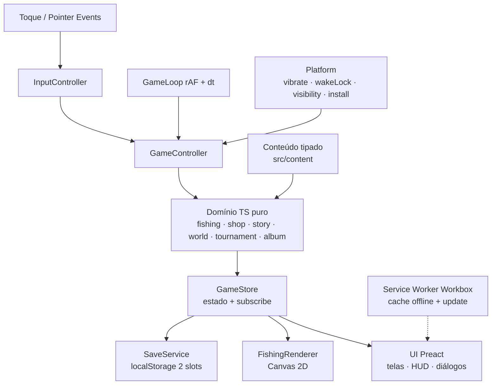
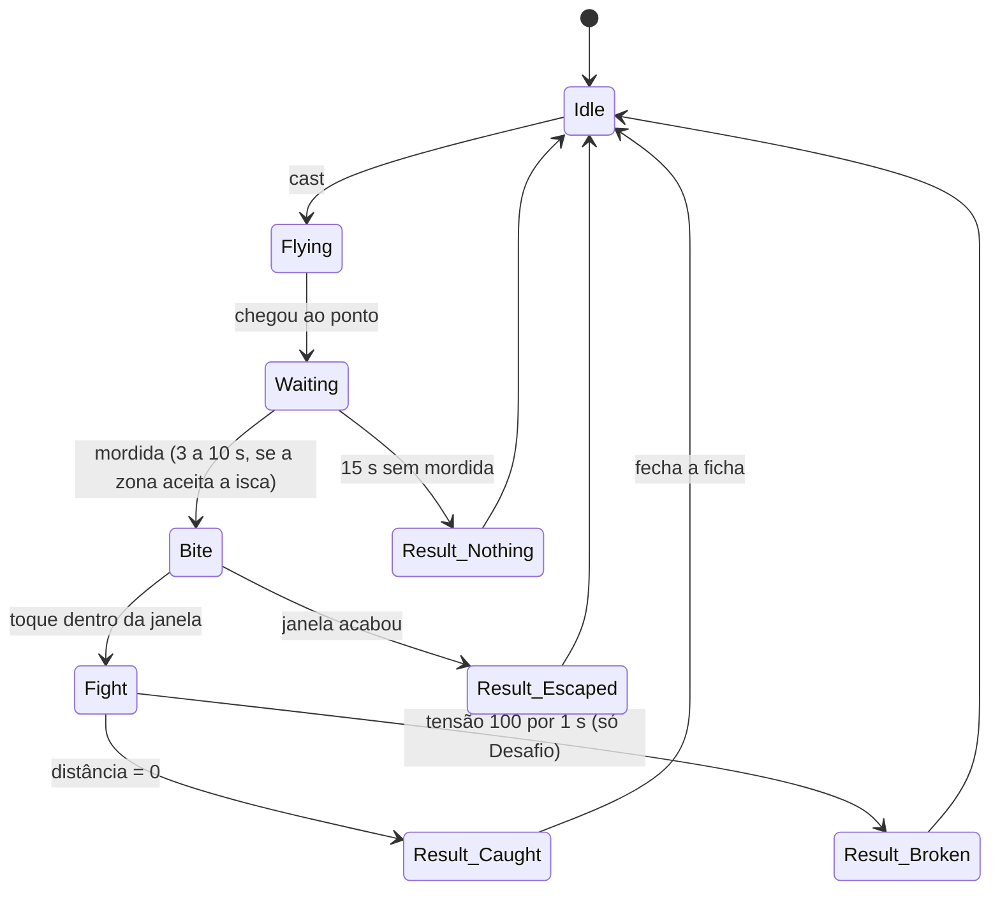

# MoscouFishing v1 Design

**Spec**: `.specs/features/v1-mvp/spec.md`
**Context**: `.specs/features/v1-mvp/context.md`
**Status**: Draft

---

## Architecture Overview

O jogo é um site estático instalável (PWA), sem servidor, com 5 episódios. Cada episódio é um pacote de conteúdo (local, espécies, equipamentos, roteiro, campeonato e carta) que roda sobre o mesmo domínio. Ele tem três camadas com uma regra de dependência só: **a interface e o desenho dependem do domínio; o domínio não depende de nada do navegador.**

- **Domínio (TypeScript puro):** máquina de estados da pesca, tensão, loja, história, torneio, álbum e salvamento. Recebe o sorteio (RNG com semente) e o tempo (`dt`) por injeção, o que torna tudo determinístico e testável com Vitest.
- **Interface (Preact, HTML/CSS):** todas as telas, textos, botões, HUD, diálogos, cartas e avisos. Por ser DOM, as regras de acessibilidade (ACES-05 a ACES-08) são medidas automaticamente no Playwright.
- **Desenho (Canvas 2D puro):** só a cena da água: represa, Adilson, isca, linha, peixe, "!" e ondinhas. Lê o estado do domínio e desenha; não decide nada.



**Fluxo de um toque na água:** `pointerup` → `InputController` converte para coordenadas lógicas → `GameController.tapWater(x, y)` → `fishing.cast()` → novo estado no `GameStore` → o `FishingRenderer` desenha a isca voando e a UI atualiza o HUD.

---

## Code Reuse Analysis

### Existing Components to Leverage

| Component | Location | How to Use |
| --------- | -------- | ---------- |
| Nenhum | - | Repositório novo; não há código para reaproveitar |
| Vite 8 + `vite-plugin-pwa` 2 (Workbox) | dependência | Build, manifest e service worker com precache |
| Preact 11 | dependência | Telas em HTML com componentes leves |
| Vitest 5 | dependência | Testes do domínio, derivados dos ACs |
| `@playwright/test` 1.64 (perfil Pixel 7) | dependência | Testes ponta a ponta no "celular": instalação, offline, acessibilidade, pausa |
| `@axe-core/playwright` | dependência | Verificação de contraste (ACES-07) |
| Skill `playwright-cli` | ambiente | Inspeção manual e prints durante o desenvolvimento |
| PixelLab MCP | ambiente | Geração da arte (personagens, peixes, cenário, ícone) |

### Integration Points

| System | Integration Method |
| ------ | ------------------ |
| Navegador (Chrome Android) | `beforeinstallprompt`, `display-mode: standalone`, `navigator.vibrate`, `navigator.wakeLock`, `navigator.storage.persist`, `visibilitychange` |
| localStorage | Salvamento em 2 slots via `SaveService` |
| Cloudflare Pages | Deploy do `dist/` a partir de repositório GitHub privado; comando de build `npm run release` |

---

## Components

### GameStore

- **Purpose**: Guardar o estado do jogo e avisar quem estiver inscrito quando ele muda.
- **Location**: `src/app/store.ts`
- **Interfaces**:
  - `getState(): GameState`
  - `update(fn: (s: GameState) => GameState): void`: aplica a mudança, notifica e agenda o salvamento quando houve evento salvável
  - `subscribe(listener: () => void): () => void`
  - `useGame<T>(selector: (s: GameState) => T): T`: hook Preact
- **Dependencies**: nenhuma além de Preact hooks
- **Reuses**: -

### GameController

- **Purpose**: Ligar toques, tempo e plataforma às funções do domínio; único lugar que muda o estado.
- **Location**: `src/app/controller.ts`
- **Interfaces**:
  - `tapWater(x: number, y: number): void`
  - `pressStart(): void` / `pressEnd(): void`: segurar e soltar (fisgada e briga)
  - `tick(dt: number): void`: chamado pelo `GameLoop`
  - `pause(): void` / `resume(): void`
  - `buy(itemId: ItemId): void` / `equip(itemId: ItemId): void`
  - `advanceDialog(): void`
  - `enterTournament(): void` / `retryTournament(): void`
  - `setDifficulty(d: Difficulty): void` / `setVibration(on: boolean): void`
- **Dependencies**: `GameStore`, domínio, `Platform`
- **Reuses**: -

### Domain: fishing

- **Purpose**: Máquina de estados de um arremesso, da mira até o resultado.
- **Location**: `src/domain/fishing.ts`
- **Interfaces**:
  - `cast(s: FishingState, target: Point, ctx: CastContext): FishingState`: limita ao alcance (PESCA-01, PESCA-02)
  - `tick(s: FishingState, dt: number, input: { holding: boolean }, ctx: TickContext): FishingState`: voo, espera, mordida, briga, tensão (PESCA-03 a PESCA-14)
  - `press(s: FishingState, ctx: TickContext): FishingState`: fisgar dentro da janela (PESCA-08)
- **Dependencies**: `rng`, `tuning`, conteúdo (espécies, zonas)
- **Reuses**: -

Estados e transições (as únicas válidas):



Física da briga, por segundo (valores iniciais em `tuning.ts`, ajustados pelo teste de balanceamento):

- Segurando: `tensão += ganhoBase × forçaDoPeixe ÷ forçaDaVara`; `distância -= velocidadeRecolhimento`
- Soltando: `tensão -= alívio`; `distância += puxadaDoPeixe × fôlegoDoPeixe`
- O fôlego do peixe cai com o tempo de briga, para que toda briga termine.
- Tranquilo: `tensão = min(tensão, 99)`. Desafio: tensão 100 por 1 s seguido arrebenta.

### Domain: shop

- **Purpose**: Comprar e equipar varas e iscas sem nunca deixar o saldo negativo.
- **Location**: `src/domain/shop.ts`
- **Interfaces**:
  - `canBuy(p: Profile, item: Item): { ok: true } | { ok: false; missing: number }`: (EQUIP-04)
  - `buy(p: Profile, item: Item): Profile`: retorna o mesmo perfil se o item já é possuído ou se falta saldo (EQUIP-03, EQUIP-06)
  - `equip(p: Profile, itemId: ItemId): Profile` (EQUIP-05)
- **Dependencies**: conteúdo (varas, iscas)

### Domain: story

- **Purpose**: Avançar cenas e objetivos do capítulo a partir de eventos do jogo.
- **Location**: `src/domain/story.ts`
- **Interfaces**:
  - `onEvent(p: Profile, e: GameEvent, ep: Episode): { progress: StoryProgress; sceneToShow?: SceneId; notice?: string }`: objetivos e cenas do episódio atual; `notice` traz "Episódio N liberado!" ou o aviso final (HIST-05, HIST-08 a HIST-10). O perfil recebido já tem o efeito do evento (compra, álbum); o controlador manda `GameStarted` ao abrir a pesca de um episódio e cuida de `pendingScene`. O encerramento final é o `closingScene` do Episódio 5
  - `currentObjective(p: StoryProgress, ep: Episode): Objective | null` (HIST-04)
  - `isTournamentUnlocked(p: StoryProgress, ep: Episode): boolean` (CAMP-01)
- **Dependencies**: conteúdo do episódio
- `GameEvent` = `Caught{species, kg}` · `Bought{item}` · `TournamentWon{id}` · `GameStarted`

### Domain: world

- **Purpose**: Controlar quais episódios e locais estão liberados, para onde o jogador pode ir e o que a loja oferece.
- **Location**: `src/domain/world.ts`
- **Interfaces**:
  - `onChampionshipWon(p: Profile, ep: EpisodeId): Profile`: libera o episódio seguinte, com todos os seus locais, uma vez só (EPI-02, EPI-08)
  - `isUnlocked(p: Profile, ep: EpisodeId): boolean` (EPI-03)
  - `travel(p: Profile, location: LocationId, all: Episode[]): Profile`: só para local liberado; guarda o último local (EPI-04, EPI-07)
  - `episodeAt(location: LocationId, all: Episode[]): Episode`
  - `shopItems(p: Profile, all: Episode[]): { rods: Rod[]; baits: Bait[] }`: só dos episódios liberados (EQUIP-09)
- **Dependencies**: conteúdo dos episódios

### Domain: tournament

- **Purpose**: Controlar os 8 arremessos, a pontuação e o resultado do torneio.
- **Location**: `src/domain/tournament.ts`
- **Interfaces**:
  - `start(def: TournamentDef): TournamentRun`
  - `recordCast(run: TournamentRun, state: FishingState): TournamentRun`: só os estados `Result_*` gastam arremesso (SAVE-06)
  - `score(run: TournamentRun): number`: soma dos 3 mais pesados (CAMP-04)
  - `standings(run: TournamentRun, def: TournamentDef): Standing[]`: em empate, o jogador fica à frente (CAMP-05)
  - `applyVictory(p: Profile, def: TournamentDef): Profile`: troféu e carta uma vez só (CAMP-06 a CAMP-08)
- **Dependencies**: conteúdo (torneio, rivais, mensagem)

### Domain: tutorial

- **Purpose**: Guiar a primeira pescaria passo a passo e afrouxar as regras enquanto isso.
- **Location**: `src/domain/tutorial.ts`
- **Interfaces**:
  - `start(): TutorialState`: passo `cast` (TUTO-01)
  - `onFishing(t: TutorialState, f: FishingState): TutorialState`: avança `cast → wait → hook → reel → release → done` conforme o estado da pesca (TUTO-03, TUTO-08)
  - `tick(t: TutorialState, dt: number, touched: boolean): TutorialState`: 10 s sem toque marca `nudge` para repetir a instrução e piscar a seta (TUTO-07)
  - `rules(t: TutorialState, d: Difficulty): FishingRules`: enquanto ativo, mordida em até 5 s, mordida sem prazo e tensão máxima 99; depois do tutorial, as regras normais da dificuldade (TUTO-04 a TUTO-06)
- **Dependencies**: `fishing` (só lê o estado)
- O `fishing` recebe as regras por `TickContext.rules`, então o tutorial não tem um caminho de código próprio para a pesca: as mesmas funções rodam com limites diferentes.

### Domain: album

- **Purpose**: Registrar espécies pegas e recordes.
- **Location**: `src/domain/album.ts`
- **Interfaces**:
  - `record(a: Album, species: SpeciesId, kg: number): { album: Album; isNewRecord: boolean }` (ALBUM-01, ALBUM-02)

### Domain: typical player simulation

- **Purpose**: Simular um jogador típico do primeiro arremesso à vitória de cada episódio, para calibrar a progressão longa.
- **Location**: `src/domain/sim/typicalPlayer.ts` (usado só por testes)
- **Interfaces**:
  - `simulateEpisode(ep: Episode, start: Profile, seed: number): { minutes: number; achievements: { atMinute: number; kind: string }[]; tournamentAttempts: number }`
- O jogador típico arremessa nas zonas da isca equipada, segura até o amarelo e solta no vermelho, compra a melhor vara que o saldo permite e entra no campeonato assim que ele libera. O tempo de cada arremesso inclui voo, espera, briga e ficha (cerca de 30 a 45 s).
- **Dependencies**: `fishing`, `shop`, `story`, `tournament`, `world`, `rng`

### SaveService

- **Purpose**: Salvar e carregar o perfil com tolerância a dado corrompido e a versões antigas.
- **Location**: `src/platform/save.ts` (I/O) + `src/domain/saveSchema.ts` (validação e migração, puro)
- **Interfaces**:
  - `save(p: Profile): SaveOutcome`: grava `mf.save.current` e move o anterior para `mf.save.previous` (SAVE-04)
  - `load(): { profile: Profile; source: 'current' | 'previous' | 'new' }`: fallback em cascata (SAVE-05, SAVE-07, SAVE-08)
  - `migrate(raw: unknown): Profile | null`: cadeia `v1 → v2 → …` (SAVE-09)
  - `requestPersistence(): Promise<boolean>` (SAVE-10)
- **Dependencies**: `localStorage`, `navigator.storage`
- Ilegível nos dois slots: copia o texto para `mf.save.corrupt.<timestamp>` e começa um jogo novo.
- Falha de escrita (cota): devolve `{ ok: false }`; a UI mostra "Não consegui salvar" uma vez por sessão.

### GameLoop

- **Purpose**: Chamar `tick(dt)` e o desenho a cada quadro, só enquanto o jogo não está pausado.
- **Location**: `src/app/loop.ts`
- **Interfaces**: `start()`, `stop()`
- `dt` limitado a 100 ms, para que voltar de uma pausa não pule a briga. Desenho limitado a 30 quadros por segundo, para poupar bateria.

### FishingRenderer

- **Purpose**: Desenhar a cena da água a partir do estado.
- **Location**: `src/render/fishingRenderer.ts`, `src/render/sprites.ts`
- **Interfaces**:
  - `mount(canvas: HTMLCanvasElement): void`
  - `draw(s: FishingViewState, t: number): void`
  - `toLogical(clientX: number, clientY: number): Point`
- Escala inteira fixa: 2× (3× em telas a partir de 540 px CSS de largura). A largura lógica é a largura da tela dividida pela escala (cerca de 180 a 206 px em celulares) e a cena é composta para no mínimo 180 px, com `imageSmoothingEnabled = false` e `image-rendering: pixelated`. Os retratos dos diálogos ficam no HTML, em resolução maior (96 × 96 px de arte), para mostrar as expressões.
- `sprites.ts`: carrega as folhas de sprite do PixelLab e anima por quadros.

### InputController

- **Purpose**: Transformar Pointer Events num toque, segurar ou soltar; nunca gestos.
- **Location**: `src/app/input.ts`
- `pointerdown` vira `pressStart`, `pointerup` vira `pressEnd`, e um `pointerup` na água fora da briga vira `tapWater`. `touch-action: none` e sem menu de toque longo. Múltiplos dedos: vale só o primeiro (ACES-09).

### Platform

- **Purpose**: Encapsular APIs do navegador que podem faltar.
- **Location**: `src/platform/`
- **Interfaces**:
  - `vibrate(ms: number): void`: sem efeito se a API não existe (PESCA-07)
  - `keepScreenOn(on: boolean): Promise<void>`: Wake Lock, readquirido ao voltar; sem efeito se faltar (TELA-01, TELA-02)
  - `onVisibilityChange(cb)`: pausa (SAVE-01)
  - `install.canPrompt()`, `install.prompt()`, `install.isStandalone()` (INST-02 a INST-04)
  - `orientation.isLandscape()` (ACES-10)

### UpdateManager

- **Purpose**: Aplicar versões novas sem interromper uma pescaria.
- **Location**: `src/pwa/update.ts`
- O `vite-plugin-pwa` roda em `registerType: 'prompt'`: a versão nova fica esperando. Ela é aplicada (`updateSW(true)`) na abertura do jogo ou ao voltar para a tela inicial, nunca durante pesca ou torneio. Depois do recarregamento, `seenVersion` diferente da versão do build mostra "Novidade no MoscouFishing!" uma vez (INST-07).

### UI (Preact)

- **Location**: `src/ui/`
- **Telas**:
  - `TitleScreen`: "MoscouFishing", subtítulo, botões "Colocar na tela" e "Jogar" (INST-01 a INST-04).
  - `InstallHelp`: a instrução do menu ⋮ (INST-03).
  - `DifficultyPrompt` (ACES-01).
  - `FishingScreen`: canvas mais o HUD em HTML (saldo, objetivo, pausa, barra de tensão, arremessos restantes) (HIST-04, PESCA-12, SAVE-03, CAMP-03).
  - `BitePrompt`: "!" e "FISGAR!" na metade de baixo (PESCA-06).
  - `FishCard`: com a descrição engraçada da espécie (PESCA-15, ALBUM-02, HUMOR-03).
  - `DialogBox`: retrato com a expressão da fala (HIST-02, HIST-03, HUMOR-02).
  - `CharacterIntroCard`: retrato grande, nome e apelido na primeira aparição; fecha com um toque (HUMOR-01).
  - `TutorialCoach`: fala curta da Jane mais seta apontando onde tocar; a seta pisca no `nudge` (TUTO-02, TUTO-07).
  - `RivalTaunts`: provocação de cada rival antes do primeiro arremesso (HUMOR-04).
  - `CatchCelebration`: Adilson posando com o peixe e "PEGOU!" antes da ficha (HUMOR-05).
  - `ImpactFx`: onomatopeia e tremor de no máximo 300 ms, por CSS `transform` no contêiner da cena (HUMOR-06).
  - `Shop` (EQUIP-01 a EQUIP-05).
  - `Album` (ALBUM-03).
  - `TournamentLobby` e `Standings` (CAMP-02, CAMP-05, CAMP-09).
  - `LetterView` e `Messages`: a carta é dividida em páginas com o botão "Continuar", sem rolagem por arrasto (CAMP-06, CAMP-10, ACES-09).
  - `Settings`: inclui "Rever tutorial" (ACES-02 a ACES-04, TUTO-09).
  - `PauseOverlay` (SAVE-02).
  - `RotateOverlay` (ACES-10).
  - `UpdateNotice` (INST-07).
  - `SaveWarning`.
  - `MapScreen`: os locais dos 5 episódios, liberados e com cadeado; o Episódio 2 mostra seus dois locais (EPI-03, EPI-04, EPI-08).
  - `TrophyRoom`: os 5 troféus, conquistados e em silhueta (TROF-01).
  - `EpisodeBanner`: "Episódio N liberado!" e o encerramento final (HIST-08, HIST-10).
- **Estilo**: tokens de cor em `src/ui/theme.css`, com pares de contraste ≥ 4,5:1. Títulos em fonte pixel legível (Pixelify Sans, licença OFL, embutida para funcionar offline) e textos corridos em fonte sem serifa do sistema a 20 px. Botões com no mínimo 56 × 56 px, todos na metade de baixo da tela.

### Conteúdo

- **Location**: `src/content/episodes/ep1.ts` a `ep5.ts` (um pacote por episódio: local, zonas, espécies, varas, iscas, roteiro, campeonato e carta), `src/content/characters.ts` (elenco compartilhado) e `src/content/index.ts` (junta os 5).
- Regras de conteúdo com teste: a Lavínia nunca diz "Adilson" nem "pai" e chama ele de "Adilsinho" em todos os episódios (HUMOR-07, HUMOR-08); cada episódio tem 6 a 8 objetivos, um deles da espécie rara e outro do álbum completo (PROG-02, PROG-03).
- Arquivos TypeScript com `satisfies` contra os tipos de `src/content/types.ts`, para o compilador pegar conteúdo malformado. Textos pendentes usam `{{PENDENTE}}`.

### Scripts de publicação

- **Location**: `scripts/`
- `check-content.ts`: procura `{{PENDENTE}}` em `src/content/` e sai com erro listando arquivo e linha de cada marcador (HIST-07).
- `check-size.ts`: soma o `dist/` e falha acima de 5 MB (INST-08).
- `npm run release` = `check-content` + `vite build` + `check-size`. É o comando de build do Cloudflare Pages.

---

## Data Models

### Profile (o que é salvo)

```typescript
type Difficulty = 'tranquilo' | 'desafio'

interface Profile {
  version: 1
  money: number                      // R$, inteiro >= 0
  rods: { owned: RodId[]; equipped: RodId }
  baits: { owned: BaitId[]; equipped: BaitId }
  settings: { difficulty: Difficulty | null; vibration: boolean }  // null = ainda não perguntado
  story: {
    episodes: Partial<Record<EpisodeId, { objectiveIndex: number; progress: number; won: boolean }>>  // progress conta o objetivo atual (ex.: 2 de 3 peixes)
    scenesSeen: SceneId[]
    pendingScene: SceneId | null
  }
  unlockedEpisodes: EpisodeId[]      // começa em [1] (EPI-02)
  currentLocation: LocationId        // último local de pesca (EPI-07)
  tutorialDone: boolean
  charactersIntroduced: CharacterId[]  // cartões de apresentação já mostrados
  tournament: TournamentRun | null   // torneio em andamento
  trophies: TrophyId[]
  messagesUnlocked: MessageId[]
  album: Partial<Record<SpeciesId, { recordKg: number }>>
  seenVersion: string
}

interface TournamentRun {
  id: TournamentId
  castsLeft: number                  // começa em 8
  catches: { species: SpeciesId; kg: number }[]
}
```

### Conteúdo

```typescript
interface Species {
  id: SpeciesId; name: string; sprite: string
  kg: { min: number; max: number }
  pricePerKg: number
  power: number                      // força na briga
  stamina: number                    // fôlego
  baits: BaitId[]                    // iscas que aceita
  rarity: number                     // peso no sorteio da zona
  description: string                // texto engraçado da ficha (HUMOR-03)
  rare: boolean                      // espécie rara do local (PROG-03)
}
interface Rod { id: RodId; name: string; price: number; force: number; reach: number; episode: EpisodeId }  // força e alcance de 1 a 10
interface Bait { id: BaitId; name: string; price: number; episode: EpisodeId }
interface Zone { id: string; polygon: Point[]; species: SpeciesId[] }

type Expression = 'normal' | 'rindo' | 'bravo' | 'chocado'
interface Character {
  id: CharacterId; name: string
  epithet: string                    // apelido do cartão, ex.: "O Rei do Bongô"
  portraits: Record<Expression, string>
}
interface DialogLine { speaker: CharacterId; text: string; expression?: Expression }  // padrão: 'normal'
interface Scene { id: SceneId; lines: DialogLine[] }
interface Objective {
  id: string; text: string
  done: (e: GameEvent, p: Profile) => boolean
  count?: number                     // quantas vezes `done` precisa acontecer (padrão 1)
  sceneOnDone: SceneId
}
interface Chapter { title: string; openingScene: SceneId; objectives: Objective[]; closingScene: SceneId }

type EpisodeId = 1 | 2 | 3 | 4 | 5
interface Location { id: LocationId; name: string; background: string; zones: Zone[] }
interface Episode {
  id: EpisodeId
  locations: Location[]               // 1 ou 2; o Episódio 2 tem Rio Jacuípe e Ponte da Cetrel (EPI-08)
  species: Species[]
  rods: Rod[]; baits: Bait[]
  chapter: Chapter
  tournament: TournamentDef
  letter: Message
}

interface TournamentDef {
  id: TournamentId; name: string     // "GuanambiCup"
  casts: 8; countBest: 3
  rivals: { character: CharacterId; kg: number; taunt: DialogLine }[]
  trophy: TrophyId; message: MessageId
}
interface Message { id: MessageId; from: string; text: string }
```

**Relationships**: o `Profile` guarda só IDs; os nomes, textos e números vêm do conteúdo. Assim, trocar um texto ou um preço não exige migrar o salvamento.

---

## Error Handling Strategy

| Error Scenario | Handling | User Impact |
| -------------- | -------- | ----------- |
| Salvamento atual ilegível | `load()` cai para o slot anterior | Nenhum; volta um passo no máximo |
| Os dois slots ilegíveis | Copia para `mf.save.corrupt.*` e começa jogo novo | Recomeça o jogo (raríssimo) |
| Cota do armazenamento estourada | `save()` devolve falha; o jogo continua | Aviso "Não consegui salvar" uma vez por sessão |
| Sem `beforeinstallprompt` | Mostra `InstallHelp` | Instrução do menu ⋮ |
| Sem vibração ou Wake Lock | `Platform` ignora a chamada | Só não vibra / a tela pode apagar |
| Sem internet | Service worker serve tudo do cache | Nenhum |
| Versão nova durante a pesca | Fica esperando até a próxima abertura ou a volta à tela inicial | Nenhum; aviso de novidade depois |
| App morto no meio da briga | Ao reabrir, volta para `Idle` com o último salvamento | Perde só aquela briga; no torneio, o arremesso não é gasto |
| Sprite não carregou | O renderizador desenha um retângulo da cor da espécie | Jogo segue jogável |

---

## Test Strategy

Cada teste nasce de um AC da spec e verifica o resultado definido nela, nunca a implementação.

| Camada | Ferramenta | Cobre |
| ------ | ---------- | ----- |
| Domínio | Vitest com RNG de semente fixa e `dt` controlado | EPI-02, EPI-05, EPI-07, EQUIP-09, HIST-09, HIST-10, PESCA-01 a PESCA-05, PESCA-08 a PESCA-17, TUTO-01, TUTO-03 a TUTO-08, EQUIP-*, HIST-01, HIST-04 a HIST-06, HIST-08, CAMP-01, CAMP-04, CAMP-06 a CAMP-09, SAVE-04 a SAVE-09, ALBUM-*, ACES-03 |
| Balanceamento da briga | Vitest simulando um "jogador" que segura até o amarelo e solta no vermelho, em 200 sementes | Duração da briga de 8 a 40 s (Success Criteria) |
| Progressão | Vitest com o jogador típico (`sim/typicalPlayer.ts`) em 50 sementes por episódio | PROG-01, PROG-04, PROG-05 |
| Conteúdo | Vitest sobre os 5 pacotes de episódio | EPI-01, EPI-06, PROG-02, PROG-03, EQUIP-01, EQUIP-02, HUMOR-07, HUMOR-08 |
| Scripts | Vitest | HIST-07 (marcador pendente), INST-08 (tamanho) |
| Navegador | Playwright, perfil Pixel 7, com ganchos de teste (`window.__mf`) ativos só no build de teste | EPI-03, EPI-04, TROF-01, INST-01 a INST-06, INST-09, PESCA-06, PESCA-07, TUTO-02, TUTO-07, TUTO-09, HUMOR-*, SAVE-01 a SAVE-03, SAVE-10, CAMP-02, CAMP-03, CAMP-05, CAMP-10, ACES-01, ACES-02, ACES-04 a ACES-10, TELA-* |
| Manual (UAT) | Android do usuário | Instalação real, modo avião, sensação da briga |

---

## Risks & Concerns

| Concern | Location (file:line) | Impact | Mitigation |
| ------- | -------------------- | ------ | ---------- |
| Versões novas: Vite 8, TypeScript 7, Preact 11, `vite-plugin-pwa` 2, Vitest 5 | `package.json` (a criar) | Incompatibilidade entre elas trava o build | A primeira tarefa monta o esqueleto e roda build, teste e PWA juntos; se falhar, fixar a major anterior da peça problemática |
| Arte do PixelLab pode demorar ou sair inconsistente | `src/assets/` | Atrasa a v1 | O código usa formas coloridas provisórias até a arte chegar; geração de arte é uma fase própria, em paralelo |
| Volume de arte dos 5 episódios: 5 cenários, cerca de 30 espécies, retratos da família e dos personagens locais | `src/assets/` | Semanas a mais e risco de passar de 5 MB | Uma tarefa de arte por cenário e por conjunto de peixes; PNG em paleta reduzida; `check:size` no gate de build |
| Simulação pode não refletir o ritmo do Adilson | `src/domain/sim/` | Episódio rápido ou lento demais para ele | Jogador típico conservador (reage devagar, joga no Tranquilo); preços e objetivos ficam no conteúdo e podem ser ajustados por atualização depois que ele jogar |
| Volume de retratos: 7 personagens × 4 expressões = 28 retratos | `src/assets/portraits/` | Rostos diferentes entre expressões da mesma pessoa | Gerar o retrato "normal" primeiro e derivar as outras expressões dele com edição de imagem do PixelLab; se não ficar bom, cair para 2 expressões (normal e rindo) |
| WhatsApp abrindo o link no navegador interno | Platform/install | Sem `beforeinstallprompt` | `InstallHelp` (INST-03) instrui "Abrir no Chrome" e o menu ⋮ |
| Android encerrando o PWA em segundo plano | SaveService | Perda de progresso | Salvar após cada evento (SAVE-04); briga interrompida volta para `Idle` |
| Bateria e aquecimento no leito | GameLoop | Celular quente e descarregando | Desenho a 30 qps, loop parado na pausa, cena pequena e sem efeitos pesados |
| Armazenamento pode ser apagado pelo navegador | SaveService | Perda total | `navigator.storage.persist()` na primeira abertura (SAVE-10) |
| Canvas não é inspecionável pelo DOM | FishingRenderer | Partes da pesca difíceis de testar no navegador | Lógica toda no domínio (Vitest) e ganchos `window.__mf` só no build de teste |
| Site publicado é acessível a quem tiver o link | Cloudflare Pages | Mensagens da família visíveis a quem receber o link | Repositório privado, `noindex` (INST-09), link compartilhado só com a família; risco aceito |
| Token do PixelLab | config do usuário | Vazamento | Fica no escopo de usuário do Claude Code, nunca no repositório |

---

## Tech Decisions (only non-obvious ones)

| Decision | Choice | Rationale |
| -------- | ------ | --------- |
| Arquitetura | Domínio TS puro + UI Preact + Canvas 2D só na água | Escolhida pelo usuário: texto nítido, acessibilidade testável, pacote pequeno (AD-002) |
| Estado | `GameStore` próprio com `subscribe` e hook | Evita mais uma dependência; o estado é pequeno |
| Conteúdo | Arquivos `.ts` com `satisfies` | O compilador barra conteúdo malformado; ainda é fácil de editar (AD-003) |
| Organização do conteúdo | Um pacote por episódio em `src/content/episodes/epN.ts` | Episódio novo é só um arquivo novo, sem mexer no domínio (AD-004) |
| Atualização do PWA | `registerType: 'prompt'`, aplicada só em tela segura | `autoUpdate` recarregaria no meio de uma briga |
| Resolução da cena | Escala inteira fixa (2× ou 3×), largura lógica derivada da tela, mínimo 180 px | Pixel art nítida sem distorção em celulares de 360 a 412 px de largura |
| Fontes | Pixelify Sans nos títulos, sem serifa do sistema no texto, embutidas | Clima retrô sem sacrificar a leitura de quem está deitado e cansado |
| Hospedagem | Cloudflare Pages a partir de GitHub privado | Grátis, aceita repositório privado, cabeçalho `X-Robots-Tag` via `_headers` |
| Git | Repositório novo com o primeiro commit já na branch `feat/v1-mvp` | Regra da organização: nunca commitar na `main` ou `master` |
